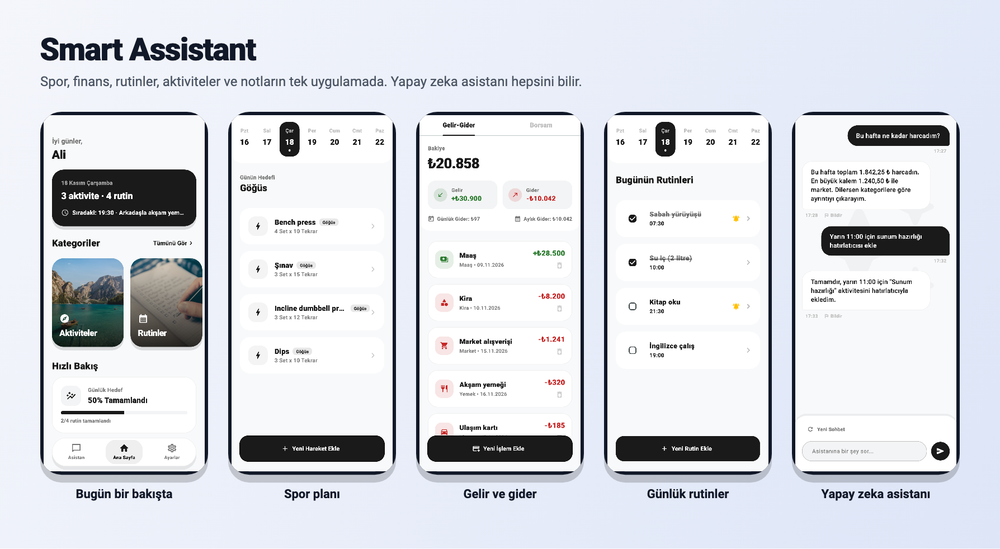
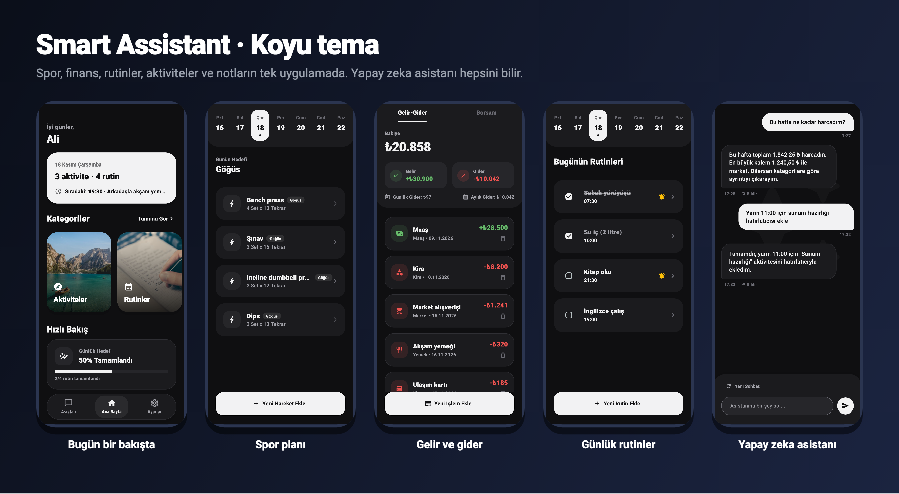
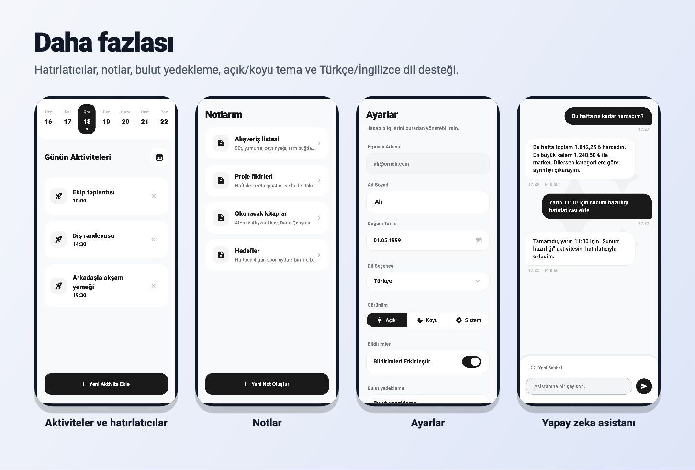

# Smart Assistant 🚀

Akıllı ve kişiselleştirilmiş bir asistan deneyimi sunan, modern teknolojilerle geliştirilmiş tam kapsamlı (full-stack) bir projedir.

---







---

### 📥 [**Eski arayüzün sunumu (PDF)**](./Uygulama.pdf) · Tekil ekran görüntüleri: [docs/screenshots](./docs/screenshots)

---

## 📌 Proje Hakkında

Smart Assistant, kullanıcıların günlük görevlerini yönetmelerine, not almalarına ve en önemlisi gelişmiş Yapay Zeka (AI) modelleri ile (Gemini veya OpenAI) sohbet ederek yardım almasına olanak tanıyan bir asistan ekosistemidir.

### 🛠️ Teknolojik Altyapı

Bu proje iki ana bölümden oluşmaktadır:

1.  **[Frontend (Flutter)](./frontend):** iOS platformu için optimize edilmiş kullanıcı dostu arayüz, yerel bildirimler, çoklu dil desteği (TR/EN) ve dinamik kullanıcı deneyimi sağlar.
2.  **[Backend (FastAPI)](./backend):** Kimlik doğrulama (JWT + yenileme token'ı), şifre sıfırlama, bulut yedekleme/senkron, veri kalıcılığı (SQLAlchemy; geliştirmede SQLite, üretimde PostgreSQL; Alembic göçleri) ve AI entegrasyonu (Gemini/OpenAI) sağlar.

---

## 📂 Dosya Yapısı

```text
smart_assistant/
├── frontend/          # Flutter Mobil Uygulaması (iOS Odaklı)
│   ├── lib/           # main.dart + screens/ + services/ + theme/ + widgets/ + l10n/
│   ├── test/          # birim, widget ve (isteğe bağlı) uçtan uca testler
│   └── ios/           # iOS projesi yapılandırması
├── backend/           # FastAPI Sunucusu
│   ├── app/           # API mantığı, modeller ve yönlendiriciler
│   ├── alembic/       # veritabanı göçleri
│   ├── tests/         # pytest testleri
│   └── .env           # Yapılandırma dosyası (.env.example'dan)
├── docs/              # Yayın kontrol listesi, dağıtım rehberi, gizlilik politikası
├── .github/workflows/ # CI (ruff, pytest SQLite+PostgreSQL, flutter analyze/test)
└── README.md          # Ana dokümantasyon
```

---

## 🚀 Hızlı Başlangıç

Projeyi yerel ortamınızda ayağa kaldırmak için aşağıdaki adımları izleyin:

### 1. Backend Kurulumu
Backend dizinine gidin ve sunucuyu çalıştırın:
- Detaylı adımlar için: **[Backend README](./backend/README.md)**

### 2. Frontend Kurulumu
Frontend dizinine gidin ve Flutter uygulamasını başlatın (MacOS/Xcode gereklidir):
- Detaylı adımlar için: **[Frontend README](./frontend/README.md)**

---

## ✨ Temel Özellikler

- 🤖 **AI Sohbet:** Gemini veya OpenAI modelleriyle; planların, rutinlerin ve harcamaların hakkında soru sor, kayıt ekletebil. Veri paylaşımı için açık izin istenir.
- 🔐 **Hesap:** E-posta ve parola ile kayıt/giriş (Google/Apple girişi yok; ileride Sign in with Apple eklenebilir), oturumun sessizce yenilenmesi, şifre sıfırlama (e-posta kodu), isteğe bağlı e-posta doğrulama, şifre değiştirme ve hesap silme.
- ☁️ **Bulut yedekleme:** Verilerin cihaz kaybında geri yüklenir ve cihazlar arasında eşitlenir (kapatılabilir).
- 🔔 **Hatırlatıcılar:** Yerel bildirimlerle aktivite ve her hafta tekrarlayan rutinler.
- 💼 **Modüller:** Spor planı, finans (gelir-gider), rutinler, aktiviteler, notlar.
- 🎨 **Tema ve dil:** Açık/koyu/sistem teması; Türkçe ve İngilizce.

---

## 📦 Yayın

App Store'a çıkış adımları ve hazırlık durumu için: **[docs/APP_STORE_CHECKLIST.md](./docs/APP_STORE_CHECKLIST.md)**.
Sunucuya kurulum (PostgreSQL, HTTPS, systemd): **[docs/DEPLOYMENT.md](./docs/DEPLOYMENT.md)**.
Gizlilik politikası taslağı: **[docs/PRIVACY_POLICY.md](./docs/PRIVACY_POLICY.md)**.

---

## 📄 Lisans

Bu proje [MIT Lisansı](./LICENSE) ile lisanslanmıştır.

---
