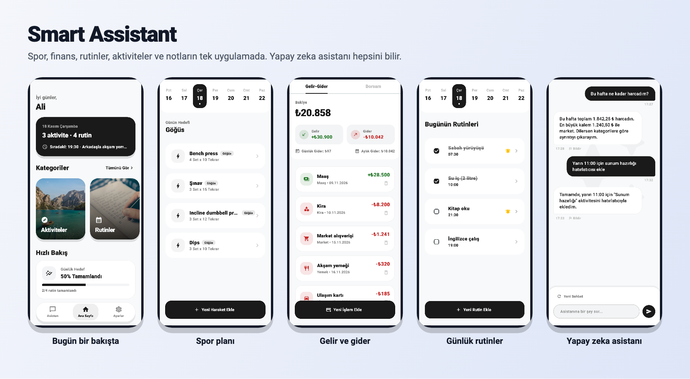

# Smart Assistant - Frontend 📱

Smart Assistant uygulamasının Flutter ile geliştirilmiş mobil arayüzü. Bu uygulama şu an için **iOS** platformuna özel olarak yapılandırılmıştır.

## 🌟 Özellikler

- **Modern & Dinamik Tasarım:** Kullanıcı dostu ve estetik bir arayüz.
- **Hesap:** E-posta ve parola ile kayıt/giriş (Google/Apple ile giriş yok), şifre sıfırlama, hesap silme.
- **AI Sohbet:** Backend ile entegre, Gemini/OpenAI destekli akıllı asistan.
- **Zengin Modüller:**
  - 🏋️ **Spor Paneli:** Haftalık spor planı ve egzersiz takibi.
  - 📈 **Finans/Borsa:** Gelir-gider takibi ve takip listesi.
  - 📝 **Notlar:** Günlük notlar ve hızlı kayıtlar.
  - 📅 **Rutinler:** Günlük rutinlerin yönetimi ve takibi.
- **Hatırlatıcılar:** Önemli aktiviteler için yerel bildirim desteği.
- **Dil Desteği:** Dinamik Türkçe ve İngilizce dil seçenekleri.
- **Tema:** Açık, koyu ve sistem teması (Ayarlar > Görünüm).

## 🛠️ Kullanılan Paketler

- [Provider](https://pub.dev/packages/provider): Durum yönetimi (State Management).
- [HTTP](https://pub.dev/packages/http): Sunucu ile iletişim.
- [Flutter Local Notifications](https://pub.dev/packages/flutter_local_notifications): Yerel bildirimler.
- [Timezone](https://pub.dev/packages/timezone): Bildirim zamanlamaları.
- [Shared Preferences](https://pub.dev/packages/shared_preferences): Kullanıcıya özel yerel veri ve ayarlar.
- [Flutter Secure Storage](https://pub.dev/packages/flutter_secure_storage): Oturum token'larını Keychain'de saklama.

---

## 🚀 Başlangıç (iOS)

### Ön Gereksinimler

- MacOS
- Flutter SDK (Son sürüm)
- Xcode (iOS geliştirme için)
- iOS Simulator veya takılı bir iPhone

### Kurulum

1. Bağımlılıkları yükleyin:
   ```bash
   flutter pub get
   ```

2. Uygulamayı çalıştırın (Simulator açıksa):
   ```bash
   flutter run
   ```

## ⚙️ Yapılandırma

Backend adresi derleme zamanında verilir (varsayılan `http://127.0.0.1:8000`, iOS Simulator için uygundur):

```bash
flutter run                                              # Simulator
flutter run --dart-define=API_BASE_URL=http://192.168.1.20:8000   # gerçek cihaz
flutter run --dart-define=API_BASE_URL=https://api.ornek.com      # üretim (HTTPS)
```

Oturum token'ı Keychain'de saklanır; uygulama yeniden açılınca oturum otomatik geri yüklenir.
Notlar, finans, rutin vb. veriler cihazda **kullanıcıya özel** tutulur; çıkış yapınca diğer hesaplar bu verileri görmez.

## 🗂️ Kod Yapısı

```text
lib/
├── main.dart               # Giriş, AppState (oturum, dil, tema, eşitleme), MyApp, AuthGate
├── screens/                # Ekranlar (main.dart'a `part` ile bağlı)
├── services/
│   ├── user_store.dart         # Kullanıcıya özel yerel depolama
│   ├── sync_service.dart       # Bulut yedekleme / cihazlar arası eşitleme
│   ├── session_storage.dart    # Token saklama (Keychain)
│   ├── notifications.dart      # Yerel bildirimler + yeniden zamanlama
│   ├── assistant_actions.dart  # AI action'larını doğrulayıp uygular
│   ├── assistant_context.dart  # AI'a gönderilen (sınırlı) bağlam özeti
│   ├── ai_consent.dart         # AI veri paylaşımı izni
│   ├── age.dart                # 13 yaş sınırı
│   └── format.dart             # Tarih/para biçimleri, hafta günleri
├── theme/app_theme.dart    # Açık/koyu renk paleti (`context.pal.xxx`) ve ThemeData
├── widgets/                # Ortak bileşenler (WeekStrip, EmptyState)
└── l10n/en_translations.dart   # TR -> EN çeviri tablosu
```

Ekranlardaki her `'metin'.tr(context)` için `en_translations.dart`'ta karşılık olmalıdır ve tabloda kullanılmayan anahtar
bulunmamalıdır; ikisini de `test/l10n_coverage_test.dart` denetler.

## 🧪 Test

```bash
flutter analyze
flutter test
# İsteğe bağlı: gerçek bir backend'e karşı uçtan uca test (backend 8001'de, ACCESS_TOKEN_EXPIRE_MINUTES=0 ile)
flutter test test/live_backend_e2e_test.dart --dart-define=E2E=true --dart-define=API_BASE_URL=http://127.0.0.1:8001
```

---

## 🎨 Uygulama Görselleri



Ekran görüntüleri (açık/koyu tema, tekil ekranlar): **[docs/screenshots](../docs/screenshots)**. Yeniden üretmek için:

```bash
flutter test test/tool/showcase_test.dart \
  --dart-define=SHOWCASE_DIR=$PWD/../docs/screenshots \
  --dart-define=FONT_DIR=<flutter-sdk>/bin/cache/artifacts/material_fonts
```

---
